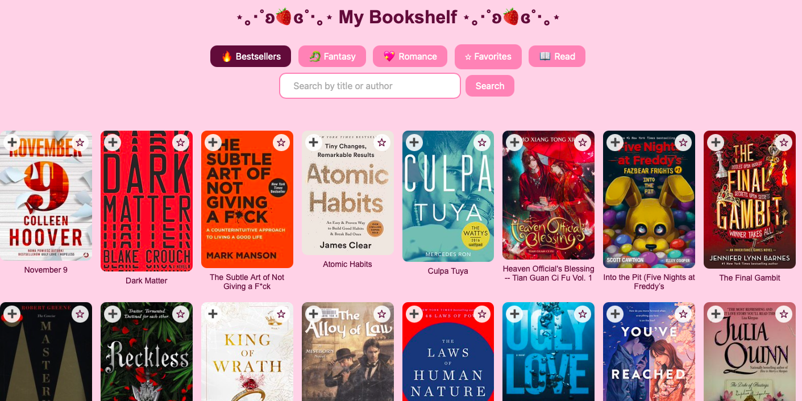
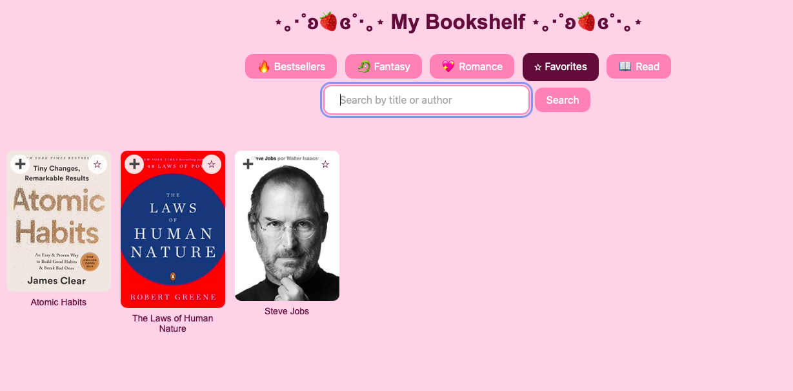

# My Bookshelf

A full-stack book app: browse books by category or search, mark favorites, track what you've read, and add a rating and notes. Everything is saved and survives restarts.




## Tech
- **Frontend:** HTML, CSS and vanilla JavaScript (`fetch`, DOM API)
- **Backend:** Python, FastAPI, Pydantic
- **Data:** [Open Library](https://openlibrary.org/developers/api) search API, proxied through the backend. Your saved books are stored in `library.json`.

## Run it
Requires Python 3.10+.

```bash
# 1. Backend
cd backend
pip install -r requirements.txt
uvicorn main:app --reload --port 8000

# 2. Frontend (new terminal)
cd frontend
python3 -m http.server 5500
```

Open http://localhost:5500.

## API
| Method | Path | Description |
|---|---|---|
| GET | `/search-books?q=` | Search Open Library |
| GET | `/books`, `/books/favorites`, `/books/read` | Saved books |
| PUT | `/books` | Create or update a saved book |
| DELETE | `/books?book_id=` | Remove a saved book |

## Ideas for later
- User accounts and a database (SQLite) instead of a JSON file
- Pagination and genre filters
- Deploy the frontend to GitHub Pages and the backend to a hosting service

Book data and covers are provided by Open Library.
